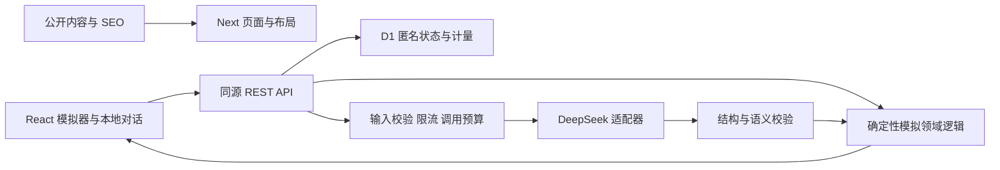

# Goodbye Startup 全项目重构设计

日期：2026-11-09（Asia/Singapore）
状态：待用户审阅；本文件中的选型和新增行为是实施建议，不代表用户已经逐项批准。
依据：`docs/project-audit-2026-11-09.md`、当前代码、用户最新重构授权、本文列出的官方资料。

## 1. 目标与成功标准

把已上线但核心流程未闭合的 AI 创业模拟器重构为可维护、可测试、可部署、可审计的参考项目。保持 Goodbye Startup 品牌、美国英文用户优先、中英双语、现有公开内容和 URL。一次模拟覆盖 180 个虚拟日，文案统一说明真实体验约 15 分钟，不将该估计包装成实测性能承诺。

范本的标准是：清晰的业务边界、可信的状态转换、可控的模型调用、可重放的测试、可复现的环境、准确的公开承诺、可追溯的发布；不是代码量、框架数或“所有工具都装上”。

必须交付：初始条件设置、完整模拟/复盘、刷新续玩、首次免费与再次开始处理、异常恢复、双语/移动端/键盘操作、领域与接口测试、浏览器场景、官方运行时构建、CI、部署/回滚文档、同步后的 README/AGENTS/PRD/架构和交接材料。

## 2. 范围与约束

- 用户已允许更改技术方案和语言；不再把旧 AGENTS 中 Next14/Gemini/Pages 的描述当作必须保留的事实。
- 保留无注册体验；不增加邮箱采集、用户账号、真实收款、自动订阅、营销邮件或额外模型供应商。
- 保留不加 UI、动画、表单、状态管理、第三方 i18n 库的约束。允许有明确用途的运行时校验、测试、代码检查、官方平台适配依赖。
- 模型继续使用已有 DeepSeek 服务；model 可由服务端环境变量配置，默认以已知的 `deepseek-flash` 为起点，不自动换付费模型或打开搜索计费。
- 用户想法、完整对话继续只在浏览器保存；服务端会在请求期间把必要内容转发给模型。新增最小匿名服务状态的范围在第 6 节明确，不把它伪称为“完全不存任何数据”。
- 保留所有现有有效内容路径；RSS 改为同一内容源生成的静态文件，不再手工维护另一份内容。
- 不变更 `wise.goodbye.help`，不顺带调整其他业务的 DNS/邮件/支付。
- 保留当前未提交改动与旧资料，先归档再迁移；新分支采用 `codex/` 前缀，复用当前 checkout。
- 本地开发、测试、可审阅变更属于本次实施范围；远程资源创建、生产流量切换、生产密钥设置及新增付费动作在具体部署方案可验收后处理。

## 3. 技术方案比较与建议

| 方案 | 收益 | 成本/风险 | 结论 |
| --- | --- | --- | --- |
| A. 保留 TypeScript/React 与 Next App Router，重建业务与服务端，迁移 Workers | 沿用内容、路由和团队知识；前后端共享领域类型与校验；可聚焦真正缺口 | 部署适配需迁移和运行时验证 | 推荐 |
| B. Astro + React island + Workers | 内容页天然轻量，模拟器独立交互 | 要重写全部页面模板与框架路由，目前没有证据表明这种改写比 A 带来更大产品收益 | 保留为备选，当前不选 |
| C. Python 后端 + 独立前端 | 适合未来复杂数据处理或模型训练 | 现在没有 Python 专属需求；增加双语言协议、服务和部署维护 | 当前应放弃 |

推荐 A 的运行时策略：最新 Cloudflare 指南推荐 vinext，但明确仍为 beta。Loop 1 先做官方兼容检查及最小生产构建/运行时验证，覆盖本项目实际使用的路由、SSR、metadata、i18n、API、静态资源和绑定。若兼容性或成熟度存在阻断，使用仍有官方文档的 OpenNext 路径，并在 ADR 记录具体缺口，不静默忽略。

目前官方 npm 元数据快照：Next 16.4.5；vinext 1.4.4；OpenNext 1.20.16（Next peer 为 `>=15.5.29 <16 || >=16.4.5`）；Wrangler 4.158.0。版本最终在兼容验证后精确锁定，拒绝靠 `--force`/忽略 peer 冲突维持构建。

本地及 CI 统一到经验证的 Node 26 LTS 补丁版本，npm + package-lock，CI 用 `npm ci`。Node 24 LTS 为运行工具不兼容时的备选。TypeScript、ESLint、React 类型包等与选定工具链匹配，不把每个包都追到 latest 当成规范。

## 4. 总体架构

采用一个可部署应用和一个小型 D1 数据库，不拆微服务、不加 ORM，不建通用 agent 编排平台。

边界：

- `src/domain/simulation/`：纯 TypeScript 类型、公式、阶段机、约束、版本；不依赖 React、HTTP 或 Cloudflare。
- `src/server/ai/`：provider、prompt 版本、响应上限、超时、结构化输出与错误归一化。
- `src/server/simulation/`：用例编排、事务预留、幂等、提交/恢复流程。
- `src/server/storage/`：小型 D1 repository 与迁移，不把 SQL 撒进组件。
- `src/server/http/`：会话、Origin/Content-Type/大小/语言/字段校验、错误码、请求 ID、安全头。
- `src/features/simulator/`：设置、对话、状态、复盘、恢复和配额状态，React reducer/Context。
- `src/content/`、`src/i18n/`：公开文章/基准来源与中英文 UI，和对话状态分开。
- `app/`：页面与路由薄层，保留 URL；无业务逻辑堆积的大页面。
- `tests/`：领域、HTTP/provider、真实本地运行时与浏览器分层测试；fixtures 明确标记为测试输出。

目录只在需要时创建。个别小模块可以合并，避免为分层制造空抽象。

## 5. 模拟协议与状态一致性

### 用户旅程

1. 首次进入设置页：创业想法、初始现金、团队人数、全职/兼职、月度成本。字段可解释、有上下限，中英双语同义。
2. 创建匿名模拟 run，初始化基线，显示当前假设；既有历史内容不会作为新系统消息取得权限。
3. 由领域层按固定里程碑推进，推荐 Day 0 → 5 → 90 → 120 → 150 → 180。每个决策点允许给定选项或自由文本；正常成功推进最多 6 次模型调用。
4. 页面同步显示阶段、现金、月收入、月成本、用户、付费用户、流失、士气和跑道；改变单位/口径时同步解释文案。
5. Day180 或现金耗尽结束；给出可行/需调整/应放弃的有条件判断、假设、风险和下一步。能导出本地 Markdown/JSON 复盘，导出不依赖虚构付费权益。
6. 刷新继续同一个 run。完成后再次开始显示明确的免费额度已用与“付费功能尚未开放”，不能死循环 loading 或伪装收款。

### 数据计算

- 模型负责场景解释、提出有边界的经济假设和决策后果；不直接随意覆盖现金余额、阶段或免费次数。
- 领域函数依据经校验的输入计算现金、收入、成本和用户变化，采用整数美分、明确的百分比/时间单位、统一舍入规则；详细公式与示例在实施计划中固定并测试。
- 阶段/天数由服务端推进；不能倒退、越界、跳过结算，也不能由 prompt injection 改配额或模型设置。
- 数值必须有限、范围合理、满足相互约束。无法解析、截断、空内容、无效枚举、越界值与自相矛盾输出均不推进状态。
- AI 回复使用 provider 支持的 JSON 输出模式，并在本地做独立 schema + 业务语义校验。JSON 合法不等于结果可信。
- 不在本轮增加实时搜索；公开基准来自有来源记录的静态假设，明确不是预测或实时观测。

### 独立审阅后补充：模型解释与结算的顺序

一次正常请求依次为：模型读取上次已提交状态与本次选择 → 提出本阶段假设、事件描述、风险建议和依据引用 → 校验 → 领域函数结算 → 服务器用模板渲染已结算的财务变化/阶段/判断 → 一并返回客户端。

模型协议不包含可直接显示的最终现金/用户总数、天数、终局枚举或“已结算结果”的段落；自由文本限定为场景与假设说明，经济指标以结构化引用表达，由 UI 代入本次权威数值。终局 verdict 由版本化的领域条件生成；复盘由已提交状态轨迹和明确标为建议的模型条目组成。这样无需在每次结算后再调用一遍模型，也不把生成文字当成计算结果。

正常调用次数固定为初始化 Day0 一次，随后 Day5/90/120/150/180 各一次，合计最多 6 次；现金耗尽则提前终止。测试检查模型字段不能覆盖结算结果，评测另查自由文本与依据是否矛盾；不宣称 schema 可以消除所有模型幻觉。

### 本地存档迁移

使用带 `schemaVersion` 的新存档；读取旧 `gs_game_state/gs_simulation_count/gs_language`，先保留旧值，再做合法性判断。
旧对话可只读查看与导出；因旧状态不可信，不导入为服务端权威账本。旧活跃用户可完成一次新的有效模拟；已用额度仅以本地旧数据提供过渡提示，不将用户可篡改的旧计数当成服务端身份凭证。
损坏、未来版本、容量不足、浏览器禁止存储时显示可恢复说明，不覆盖原值，不白屏。

## 6. 匿名状态、幂等、隐私与额度

新增 D1 的唯一必要性：跨实例保存权威数值、并发版本和模型调用预留，避免浏览器篡改状态、双击/重试重复调用和“内存限流”假象。

服务端存：随机匿名会话标识的哈希、run ID、数值状态/版本、请求 ID 与处理状态、使用次数、token 计量、时间戳。**不存**原始 IP、创业想法、用户消息、AI 原文或完整 prompt。必要的防滥用标识使用服务端 HMAC；应用日志也不得收集上述文本。

会话通过 Secure/HttpOnly/SameSite=Lax cookie，所有写 API 同源 Origin 校验；客户端发送 run ID 不能访问其他匿名会话。无账号系统只能做到“每个匿名浏览器会话一次”，不能宣称每个自然人永久一次，清除全部 cookie/浏览器数据可产生新身份。

生命周期建议：run 数值与操作元数据保留至最后一次成功推进后的 30 天；从未成功的草稿以创建时间为起点。继续成功推进可延长 run 恢复期，普通查询/失败不能无限续期。匿名额度 cookie/计数从首次成功起保留 180 天，查询不延长；匿名标识在未成功草稿阶段也有明确过期与清理规则，不积累无限草稿。用户可主动删除自己的服务端数值和本地对话，但删除操作不重置尚有效的免费计数。隐私页明确区别。

独立审阅后补充的产品政策建议：创建只预留唯一免费 allocation，同一匿名会话只能有一个可运行 allocation；第一次校验成功且提交状态时标记已使用。首轮失败不占已用次数，但每次实际 provider 尝试都记入该 allocation 的 10 次上限；重新创建草稿不能重置此计数。已有成功进度后主动放弃、删除或到期不补发免费资格。尝试次数耗尽则显示明确的服务/预算终止状态，保留已产生进度与本地导出，不能继续伪装 loading 或偷偷再调用；公开文案说明免费模拟受技术用量和恢复期限约束，不保证供应商永远可用。

过期行为：服务端返回 `RUN_EXPIRED`；保留本地只读对话和导出，禁止用本地数据重新建立权威账本；恢复与 requestId 幂等有效期等于该 run 保留期。额度仍在 180 天有效期时不自动获得新 run，界面解释期限。匿名标识或额度记录到期后视作新的匿名使用周期，不宣称对自然人永久限一次。以上是本设计提出的明确行为，需随设计一并审阅，不能当作旧 PRD 已有政策。

每次推进必须携带 expectedVersion 与随机 requestId。事务先原子预留该 run 的操作和调用预算，然后调用模型，最后校验并以版本比较提交；同时最多一个正在处理的推进。重复成功 requestId 返回已提交的数值状态，不再次调用模型。原 AI 文本没有服务器存档，响应丢失时显示“已恢复数值，本次文本未保留”，不制造原文。

模型请求超时/进程中断存在“上游可能已收费”的不确定性。调用预算不因客户端取消或超时自动退回；过期操作通过受控状态机恢复，旧请求晚到不得覆盖新版本。端到端测试必须覆盖双标签、重复请求、丢包和迟到响应。

## 7. AI 服务与安全边界

- DeepSeek URL、model、max_tokens、温度均由服务端确定，用户不能提交任意 URL/模型/密钥。
- 新 API 输入建议上限：请求体 32 KiB、用户单条 2000 字符、想法 2000 字符、最近对话最多 12 条/合计 12000 字符；最终值写入常量与测试，不靠注释。
- 模型响应有字节/字符串上限；默认 45 秒超时、4096 输出 token 上限；模型失败不无限自动重试。一个 run 最多 10 次 provider 尝试（6 个正常阶段加受限恢复），测试不得默认访问真实服务。
- Cloudflare Rate Limiting binding 做短窗缓解（例如匿名会话/IP HMAC 每分钟 6 次）；它是近似、按位置限流，不当成严格全局预算。
- D1 预留账本保证 run 尝试上限和可配置的全站每日调用上限；生产 `AI_DAILY_CALL_LIMIT` 未配置或为 0 时拒绝真实推理。本地 mock 模式只在本地/test 有效，生产拒绝以 mock 冒充成功。
- 同源、安全头、CSP 与客户端脚本行为一起验证；禁止模型 HTML 直接进入 DOM。聊天先用安全文本/结构化块渲染，不自行写 HTML 正则“消毒器”。
- API 成功 `{ data, requestId }`；失败 `{ error: string, code, requestId }`，HTTP 400/401/403/409/413/429/502/503/504 按实际含义使用。不返回 stack、密钥或完整上游响应。
- 诊断保留上游错误 code/status 和经过明确脱敏的 message；开发调试如需查看完整 provider 错误只能在受控本地输出中处理，不公开给终端用户或写入日志。不得把 provider 故障伪装成模型正常回复。
- 模型/提示词/领域规则版本与 token 用量关联记录，能追踪异常，不记录 prompt。

## 8. 界面、i18n、内容与公开承诺

- 首页以“输入想法、看清假设、做决策”为中心，保留品牌和现有内容；模拟器采用可见的设置/运行/完成/额度耗尽/错误状态。
- 手机正常页面滚动，处理软键盘与 safe-area，避免全局锁 body 导致说明区不可达。键盘焦点、表单 label、错误定位、触控尺寸、prefers-reduced-motion 均验收。
- 修复 React 订阅式语言状态与 hydration。英文 SSR；初始 client render 与 SSR 一致，挂载后应用已有用户语言偏好，html lang 同步更新；不在首 render 直接读 localStorage 造成差异。
- 保持同一 URL 的辅助中文体验，本轮不扩展独立中文 SEO 路由；所有 UI/错误/单位均通过字典，不靠整页 reload。
- 稳定性优先保留 Tailwind 3.4；若当前生态验证表明必须升级再记录理由，不为换版本重写全部样式。
- 本轮真实支付仍关闭；免费入口可用，付费按钮明确显示尚未开放。价格冲突在新定价页中停止展示不确定的 $0.99/次，不新增收费方案；Pro/Lifetime 仅作为未来计划说明，不承诺已可购买、退款或账单门户。
- 所有“工作原理”涉及天数处说明模拟时间和约 15 分钟；统一“模拟/simulation”。
- 公开内容有统一 typed registry（slug、标题、摘要、发布日期/更新日、来源）；标题预算、canonical、OG、sitemap、RSS、JSON-LD 来自同一来源，自动检查重复/遗漏。
- 评估 Cloudflare AI Agent Visibility：本项目适合公开机器可读内容，先提供 llms.txt、公共 Markdown 与 JSON-LD，不上传对话，不为模板新增 Workers AI/KV。它不保证搜索排名或被引用。
- 已查看 awesome-selfhosted 候选目录；当前没有独立 CMS、分析平台或 LLM 网关需求，不引入新的自托管服务与升级/备份负担。

## 9. 工程与验收证据

- 代码质量：strict TypeScript、ESLint flat config、格式检查、无裸 any/双重类型断言；异常和异步 Promise 明确处理；组件与公共函数遵循统一约定。
- 单元：领域公式/边界/阶段、状态迁移、存档版本、翻译完整性和公开内容元数据。
- 集成：provider 空白/坏 JSON/语义错误/超时/429/401；D1 事务与并发；身份隔离、Origin、请求大小、重复 requestId、旧版本冲突、预算达到上限。
- 浏览器：手机与桌面、英文与中文、输入法组合输入、键盘操作、刷新、双标签、错误重试、完整 run、终局、第二次开始；以确定性测试 provider 驱动，不把 mock 当作真实 AI 验证。
- 运行时：选定 adapter 的生产构建，Wrangler 本地 Workers/D1 预览，静态资源/所有公开路由/API/绑定检查。没有本地测试结果就不宣称 Workers 兼容。
- CI：依赖锁定安装、format/lint/typecheck、领域与集成测试、构建、浏览器场景；不把部署绑到未经审查的 main 推送。
- 安全：依赖审计、提交前密钥检查、无 prompt 日志、公开内容无私密泄漏、错误不泄漏。
- 模型质量：建立固定的 SaaS、消费应用、极少资金等评测场景；确定性测试检验协议/状态，人工抽检真实回答验证有效性，不用测试替代模型质量判断。
- 停止条件：验收清单通过、无已知高优先级问题，未验证/外部条件明列；不机械重复全部测试。

## 10. 部署与回滚

移除 next-on-pages 和修补构建产物的脚本，改为官方适配器与 wrangler.jsonc。新兼容日期采用实施时已验证日期，并保留 nodejs_compat；原 2025-09-01 约束来自旧链路，不机械套用到新链路。

先完成本地和预览产物；拟新增独立 Worker 与 D1，保留现有 Pages 生产站作为回滚目标。明确新 bindings、secret 名、迁移命令、环境变量验证、资源费用与可用权限后，才能操作远程环境。生产域名切换不与开发提交绑定；不删除 Pages 项目，不改 wise/邮箱配置。

数据库迁移优先向前兼容，提供备份/回滚说明；运行标识版本写入健康检查，不返回 secret 或部署内部细节。发布后核对全部 15 页、RSS、robots、sitemap、canonical、安全头及受控的 API 行为，不能只看首页 200。

## 11. Loop 计划与第一性原理/对抗审查

1. 归档基线及工程/运行时验证：确认官方兼容路径，保留当前改动。
2. 领域与匿名存储：先验证状态、事务和额度，再接 UI。
3. AI 边界：mock/异常/成本/语义校验完整后连接现有供应商。
4. 用户流程、i18n、内容与 SEO：全部旧 URL、文案、隐私及承诺同步。
5. 完整验收、独立复审、文档及可审阅发布包。

第一性原理：产品价值来自可解释且一致的决策反馈。当前失败的根因是模型文字与产品状态脱节、客户端作为计费/状态信任边界、文档描述代替实现。因此确定性领域层、服务端最小匿名状态和协议校验先于换语言或扩展页面。

对抗审查：
- “纯客户端保持最简单”：无法跨实例拒绝重放、控制每 run 调用成本；因此仅新增必要 D1 元数据，不上账号和云端聊天。
- “官方推荐就是零风险”：vinext beta 仍须实测兼容，保留 OpenNext 可验证降级路径；没有证据不直接切生产。
- “AI 输出 JSON 就可信”：必须校验语义与状态转换；公式和额度属于应用权限，模型不能决定。
- “免费一次就是防滥用”：无账号不能证明自然人身份，cookie 清理仍可绕过；IP 短窗限流加全站硬预算控制损失，文案明确范围。
- “重试可以自动补齐”：上游可能已经收费；先预留、限制尝试、拒绝重复提交，不承诺跨网络严格 exactly-once AI 计费。
- “范本必须付费/账号/监控全家桶”：这些增加外部义务，当前价值不足；保留可观察结构，不安装额外平台。

结论：**存活，但需以兼容验证和具体数据边界为前提实施**。若部署适配不能通过真实 Workers 验证则修改实现路线；不以迁移名义降级核心验收。

## 12. 官方来源（2026-11-09 核对）

- Cloudflare Next.js 指南（vinext 推荐、beta 声明）：https://developers.cloudflare.com/workers/framework-guides/web-apps/nextjs/
- next-on-pages 弃用说明：https://github.com/cloudflare/next-on-pages
- OpenNext 安装和绑定：https://opennext.js.org/cloudflare/get-started
- Next16 升级指南与独立 lint：https://nextjs.org/docs/app/guides/upgrading/version-16
- Node 受支持版本：https://nodejs.org/en/about/previous-releases
- Workers 最佳实践：https://developers.cloudflare.com/workers/best-practices/workers-best-practices/
- Workers 限流精度边界：https://developers.cloudflare.com/workers/runtime-apis/bindings/rate-limit/
- D1 绑定 API：https://developers.cloudflare.com/d1/worker-api/d1-database/
- DeepSeek JSON 输出及空白处理：https://api-docs.deepseek.com/guides/json_mode/
- DeepSeek Chat Completions：https://api-docs.deepseek.com/api/create-chat-completion/
- Astro 官方 Cloudflare 适配（备选）：https://docs.astro.build/en/guides/integrations-guide/cloudflare/

版本来自 npm 官方 registry 只读查询，尚未安装或声称该组合已经通过构建。

## 13. 独立设计审查记录

2026-11-09，独立 builder check 提出三个重要契约缺口：生成叙事与结算顺序、免费资格消耗时点、数值记录与额度记录的不同过期行为。已在第 5–6 节补齐建议行为；其他实现细节交由实施计划固定。审查没有将测试通过等同于已实现，目前仍处设计阶段。
