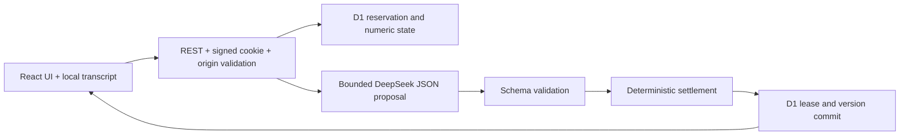

# Architecture and decisions

Updated 2026-11-09. The approved design is `superpowers/specs/2026-11-09-full-project-refactor-design.md`; this document describes the implementation.

## One application, explicit trust boundaries

Keep TypeScript, React 19 and App Router URLs. Next 16 API compatibility runs on vinext 1.4.4, Vite 8 and Cloudflare Vite plugin 1.67.0. Cloudflare currently recommends vinext but labels it beta. Its documented Wrangler configuration path is used because default `cf` initialization requires Vite plugin v2 beta. The compatibility check reported no unsupported imports. Both development and built workerd runtime are acceptance gates; a build alone is insufficient. `worker.ts` preserves the adapter fetch handler and adds a scheduled purge. No custom binding bridge or fetch compatibility patch is used.

The old next-on-pages integration and async_hooks webpack external patch were removed. `compatibility_date=2025-09-01` and `nodejs_compat` remain pinned; change them only with runtime regression evidence. OpenNext is a documented fallback if vinext has a concrete blocking defect, not an additional runtime dependency.

Tailwind 3.4 plus custom CSS, React state/context and a small i18n provider are sufficient. Zod validates boundaries; no UI, animation, form, state or i18n library was added. No ORM, queues, vector database, agent framework or provider abstraction was needed.

## Deterministic domain

Timeline: `[0,5,90,120,150,180]`. Version 0 is the setup. The first successful response creates version 1 at Day 0 without changing cash. Later intervals use `months = deltaDays / 30`:

- retained customers = floor(previous customers × (1 − monthly churn)^months)
- acquired customers = floor(visits × signup rate × paid rate)
- monthly revenue cents = customers × price cents
- cash = clamp(previous cash + round((revenue − monthly cost) × months) − one-time cost, 0, 1,000,000,000 cents)
- runway = cash / monthly net burn; null if there is no positive net burn

All money uses integer USD cents. Rates are bounded to [0,1]. Cash clamps at $10 million to bound the teaching model; costs, visits and price have explicit schema caps. Customers are retained first, new users added afterward; interval revenue is treated as constant. These are deliberate simplifications, not accounting or forecasting. Team/commitment are context for AI, not independent arithmetic multipliers. Bankruptcy or Day 180 ends the run. A positive-cash break-even scenario is viable; positive cash below break-even needs revision; zero cash means abandon. Narration cannot change these rules.

## D1 atomicity and retention

Four tables: sessions, runs, operations, daily_budget. Signed anonymous IDs are HMAC-hashed before storage. A batch inserts an operation only if ownership, version, expiry, allocation attempts, daily budget and absence of a live pending request all match. Counter updates require the same fresh token. SQL zero-row outcomes are checked explicitly; D1 batch atomicity alone does not turn them into errors.

Provider work is outside the transaction. A 60-second lease covers the 45-second upstream timeout. Commit requires the original lease and expected version; late results cannot overwrite a replacement. Successful request IDs replay the current numeric state without inference or stored narrative. Failed IDs report failure; an explicit new attempt uses a new ID. The snapshot is read after reservation to avoid races between tabs. There is no automatic provider retry.

The daily budget counts attempted calls, including failures; it is a strict application guard across sessions. It is not a currency-denominated provider billing limit. The separate Cloudflare limiter is approximate per location. Each allocation has at most 10 attempts. First success uses eligibility; deleting a run does not reset counters. Session metadata expires at 180 days (from creation if unused, first success if used). Run state expires at 30 days; expired reads fail immediately. Cleanup runs daily at 03:00 UTC and opportunistically on session access; physical removal can lag expiry by one scheduled interval. Deleted runs cascade operation snapshots. No transcript is in D1.

## Dependency and content decisions

Exact direct versions are committed. ESLint 10 + typescript-eslint + React Hooks rules avoid obsolete Next preset peers. Temporary transitive overrides address known advisories: minimatch 11.0.5, fflate 0.8.3, postcss-selector-parser 6.1.6 and ajv-formats → ajv 8.20.0. Remove each override when upstream resolves it; test before changing major transitive versions. npm audit and build are required.

Public registry owns 15 URLs, metadata, four RSS articles and Markdown exports. FAQ visible answers and JSON-LD use the same translation object. Public content never imports storage. Lightweight llms.txt, Markdown and JSON-LD meet the AI-readability need; Cloudflare's full Agent Visibility template with Workers AI/KV would add resources without a current requirement. No self-hosted SaaS replacement is required, so awesome-selfhosted does not justify a new service here.

Official references checked 2026-11-09: [Cloudflare Next.js](https://developers.cloudflare.com/workers/framework-guides/web-apps/nextjs/), [vinext](https://github.com/cloudflare/vinext), [D1 batch](https://developers.cloudflare.com/d1/worker-api/d1-database/), [DeepSeek JSON mode](https://api-docs.deepseek.com/guides/json_mode/), [DeepSeek completions](https://api-docs.deepseek.com/api/create-chat-completion/), [Workers rate limits](https://developers.cloudflare.com/workers/runtime-apis/bindings/rate-limit/).

Build emits upstream vinext/Vite sourcemap and chunking warnings. They do not fail the build, but third-party stack mapping may be incomplete. Runtime/browser checks are required; beta adapter behavior remains a release risk to validate in remote preview.
